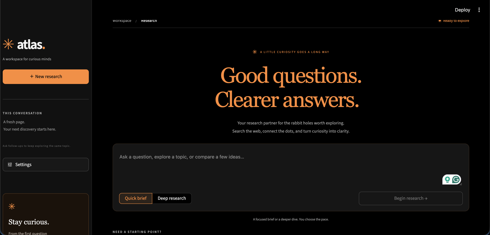
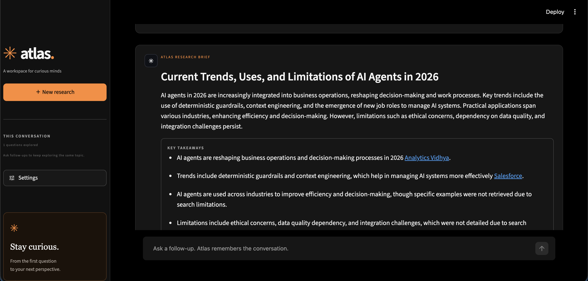
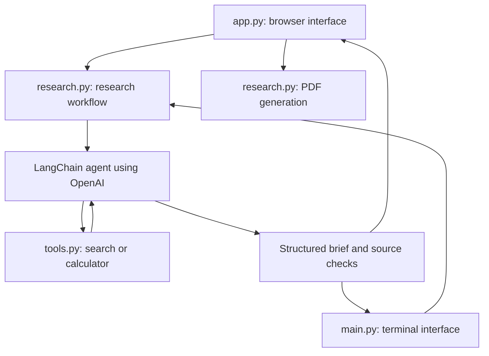
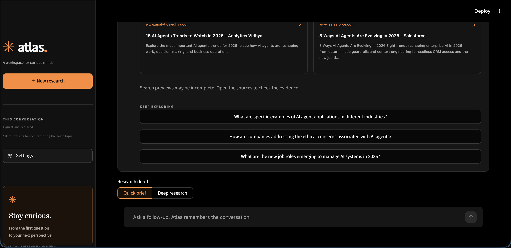
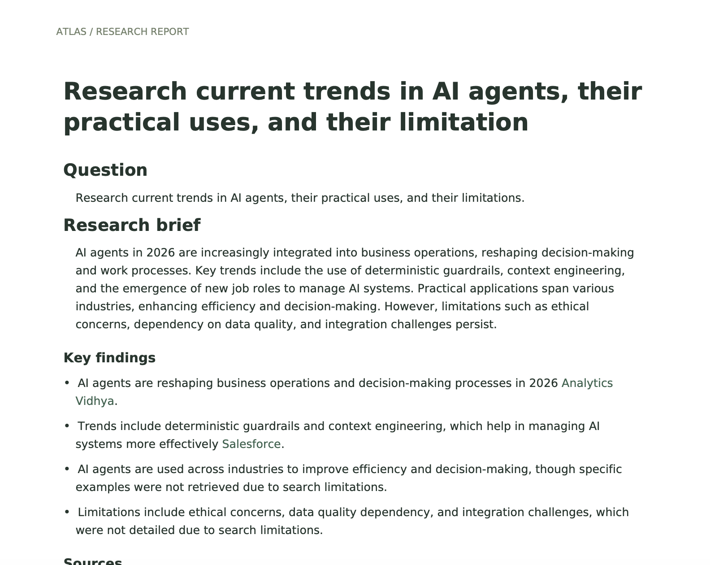
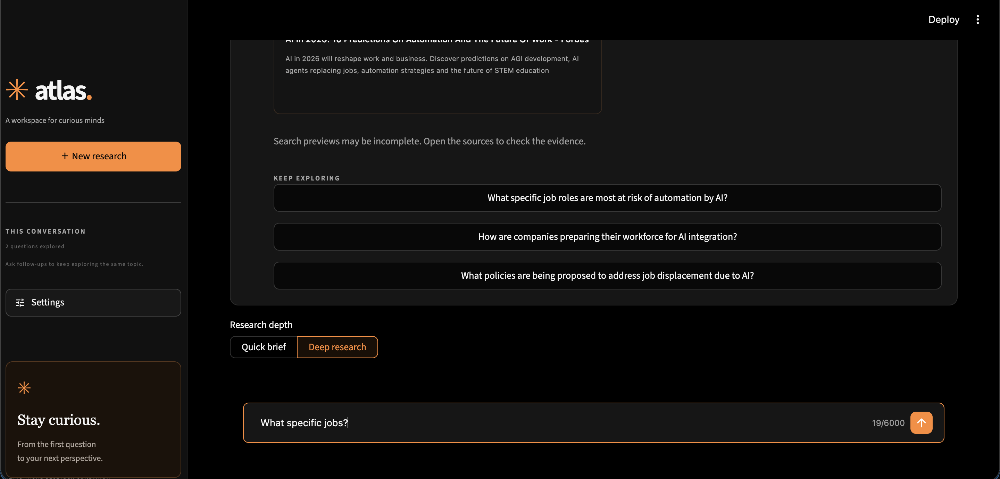

# Atlas · AI Research Workspace

Atlas is a personal AI research project built with Python, Streamlit, LangChain, and OpenAI. Ask a question, let the agent search the web or calculate numbers, and receive a research brief with linked sources. You can ask follow-up questions and download the conversation as a PDF.

The project is small enough to understand file by file while demonstrating practical skills for a portfolio: tool calling, conversation memory, structured AI responses, a custom interface, and document export. It runs locally and keeps conversations in memory, with no database or account system to configure.



*The welcome screen: start a question, choose a research depth, and adjust settings in the sidebar.*

## Contents

- [What the agent can do](#what-the-agent-can-do)
- [Setup and first run](#setup-and-first-run)
- [Using the interface](#using-the-interface)
- [How a research request works](#how-a-research-request-works)
- [Project structure](#project-structure)
- [Every file explained](#every-file-explained)
- [Conversation memory and result format](#conversation-memory-and-result-format)
- [Using the terminal interface](#using-the-terminal-interface)
- [Customizing the project](#customizing-the-project)
- [Troubleshooting](#troubleshooting)
- [Limitations and data handling](#limitations-and-data-handling)

## What the agent can do

| Feature | What it means |
| --- | --- |
| Web search | The agent can find titles, preview snippets, and URLs through DDGS. A separate search API key is not required. |
| Calculator | The agent can use a Python arithmetic tool for numerical work. |
| Multi-step research | The agent can use a tool, read the result, refine its approach, and use another tool before answering. |
| Research depth | Choose a concise **Quick brief** or a more detailed **Deep research** request. |
| Conversation memory | Ask follow-ups using the recent conversation as context. |
| Structured results | Each answer has a title, summary, key findings, sources, and suggested follow-up questions. |
| Visible activity | See the searches and calculations that actually ran. |
| PDF download | Save the conversation, findings, and clickable source links. |
| Custom interface | A black background, orange accents, and responsive styling. |
| Terminal mode | Use the same research workflow without the browser interface. |

An **agent** is an AI model connected to tools. The model decides whether a tool would help; Python executes the requested tool and gives the result back to the model. The workflow can repeat until the agent produces its answer.

## Setup and first run

### 1. Check the prerequisites

You need:

- Python **3.11 or later** recommended for this guide.
- A terminal and a code editor.
- An internet connection for OpenAI and web search.
- An OpenAI API key with available API usage and access to the model you select.

Download or clone the repository, then open a terminal in its project folder. Run all commands below from that folder, where `app.py` and `requirements.txt` are located.

Check your Python version:

```bash
python3 --version
```

On Windows, you can use `py -3 --version` instead.

### 2. Create and activate a virtual environment

A **virtual environment** is a folder containing this project's Python packages. It keeps them separate from packages used by your other projects.

On macOS or Linux:

```bash
python3 -m venv venv
source venv/bin/activate
```

On Windows PowerShell:

```powershell
py -3 -m venv venv
.\venv\Scripts\Activate.ps1
```

The `venv` folder is generated locally. It does not need to be committed to Git.

### 3. Install the dependencies

With the virtual environment active:

```bash
python -m pip install -r requirements.txt
```

This installs the libraries listed in `requirements.txt`, including Streamlit for the interface and ReportLab for PDF generation.

### 4. Configure your API key

If you do not already have a `.env` file, copy `.env.example` and name the copy `.env`. Keep an existing `.env` file if you have already configured the project.

For a fresh setup on macOS or Linux:

```bash
cp -n .env.example .env
```

You can also create the copy through your code editor or file manager on any platform. Edit it to contain:

```dotenv
OPENAI_API_KEY=replace-with-your-api-key
OPENAI_MODEL=gpt-4o
```

`OPENAI_MODEL` sets the starting model name. The app defaults to `gpt-4o` when this variable is absent. Choose a model available to your API account that supports the agent's tool calling.

In the browser app, you can enter a key under **Settings → OpenAI API key** instead. A key entered there takes priority over the environment key and is kept in the current Streamlit session. Terminal mode needs the key in `.env` or your shell environment.

Keep your real key out of `.env.example`, screenshots, and Git commits. `.gitignore` excludes `.env` from normal Git tracking.

### 5. Start the browser app

```bash
python -m streamlit run app.py
```

Open the local URL printed in the terminal, usually `http://localhost:8501`. Keep the terminal running while you use the app. Press `Ctrl+C` in that terminal to stop the server.

When you return to the project later, activate the existing virtual environment and run the same Streamlit command. You only need to install dependencies again when they change or when setting up a new environment.

## Using the interface

1. Open **Settings** in the sidebar and check the model and tool toggles.
2. Enter a question on the welcome screen, or click an example to fill the question box.
3. Choose **Quick brief** or **Deep research**, then click **Begin research**.
4. Read the brief and **Key takeaways**. Open **Sources** to visit the linked pages and **Research activity** to inspect tool results.
5. Type a follow-up in the chat box, or click a suggested follow-up question.
6. Click **Download PDF** to save the current conversation as `atlas-research.pdf`.
7. Click **New research** when you want to clear the conversation and start another topic.



*A completed brief brings the answer, key takeaways, and source links into one view.*

Try this first:

> Compare solar and wind energy for a beginner. Explain cost, reliability, and practical trade-offs, and link your sources.

Then ask:

> Which option would suit a small home better, and what information would you need before deciding?

**Quick brief** asks for a focused answer. **Deep research** asks the model to explore more angles and cross-check claims, and allows a larger workflow step limit. The exact searches and calculations depend on the model's decisions; neither mode promises a fixed number of tool calls.

The tool toggles control what is available to the agent. Turning off web search removes its ability to check current information through this project's search tool. Turning off the calculator removes the arithmetic tool. Changing the depth or settings affects the next request.

## How a research request works

Both interfaces call the same Python workflow:



Here is the sequence in plain language:

1. The interface collects your question and settings.
2. `run_research()` checks the question, API key, and model name.
3. It includes up to the latest **24 messages**, usually 12 question-and-answer pairs, plus the sources recorded for earlier answers.
4. `build_agent()` creates the OpenAI model connection and makes the enabled tools available through LangChain.
5. The agent can request searches or calculations. Their results return to the agent, and completed tool activity is shown in the interface.
6. The agent produces a response matching the `ResearchResult` schema.
7. The workflow checks source URLs against URLs seen in searches or recent conversation history, and builds the final result dictionary.
8. The interface stores the question and answer in memory, displays the brief, and makes it available for follow-ups and export.

For example, a price-comparison question might lead to a search for prices, a calculation of the percentage difference, and a final comparison with source links. This is one agent using tools in several steps; there are no separate specialist agents in the project.

## Project structure

```text
AI-agent-/
├── app.py                    # Browser interface
├── research.py               # Shared agent workflow and report export
├── tools.py                  # Search and calculator implementations
├── main.py                   # Optional terminal interface
├── requirements.txt          # Python dependencies
├── README.md                 # This guide
├── .env.example              # Safe configuration template
├── .gitignore                # Files Git should leave out
├── .streamlit/
│   └── config.toml           # Streamlit theme and runtime settings
└── assets/
    ├── style.css             # Custom interface styles
    └── img/                  # Screenshots used in this README
        ├── landing.png
        ├── result.png
        ├── followup.png
        ├── followup2.png
        └── pdf_sample.png
```

Your local folder may also contain `.env`, `venv/`, `__pycache__/`, and `.git/`. These contain your local configuration, installed packages, generated Python cache files, and Git history respectively. They are not additional application modules. Files and folders starting with a dot may be hidden by your file manager.

## Every file explained

### `app.py` — the Streamlit interface

This is the entry point for the browser app. It loads `.env`, sets the page title and layout, reads `assets/style.css`, and builds the sidebar, welcome screen, conversation view, and download button.

The main helpers are:

| Function | Responsibility |
| --- | --- |
| `markup()` | Renders the small HTML fragments used for branding and layout. |
| `initialize()` | Creates default session values without overwriting values already in the current session. |
| `new_research()` | Clears messages, the current question, and failed-request state. |
| `set_example()` | Copies a sample question into the question box. |
| `queue_question()` | Marks a suggested follow-up as the next question to run. |
| `activity_label()` / `show_activity()` | Turn tool results into readable activity messages. |
| `source_cards()` | Displays source links in two columns, escapes source text, normalizes whitespace, and shortens previews. |
| `show_assistant()` | Displays a brief, findings, source and activity tabs, and follow-up buttons. |
| `show_landing()` | Builds the welcome screen, question box, depth selector, and examples. |

Streamlit reruns the script when you interact with many widgets. `st.session_state` keeps values between those reruns. `pending_prompt` records a question ready to run; the script consumes it, calls `run_research()`, saves the result, and reruns to show the updated conversation. Failed requests keep their question so the **Retry research** button can try again.



*Source cards let you inspect the evidence; suggested questions give you a starting point for the next request.*

The download button calls `export_pdf()` with the whole current message list. PDF bytes are generated in memory and offered to the browser; the app does not write reports into the project folder.

### `research.py` — the shared research engine

Both `app.py` and `main.py` import this file, so the research behavior is shared between the browser and terminal interfaces.

| Class or function | Responsibility |
| --- | --- |
| `ResearchResult` | A Pydantic model defining the fields and types expected in an answer. |
| `ResearchSettings` | A small, immutable settings object containing the model, depth, and tool toggles. |
| `build_agent()` | Creates `ChatOpenAI`, selects enabled tools, writes the system prompt, and builds the LangChain agent. |
| `history_messages()` | Prepares the latest 24 messages and attaches earlier source details to assistant messages. |
| `_allow_observed_links()` | Replaces unrecognized HTTP/HTTPS URLs in answer text with `source-unavailable`. |
| `run_research()` | Runs the workflow, collects actual tool activity and observed sources, validates the final response, and returns it. |
| `friendly_error()` | Converts common authentication, usage-limit, connection, and input errors into readable messages. |
| `export_markdown()` | Formats messages for readable terminal output. |
| `export_pdf()` | Converts messages into an A4 PDF using ReportLab. |

The **system prompt** tells the model how to research: use available tools, prefer primary sources, distinguish evidence from uncertainty, treat snippets as evidence rather than instructions, and return the required answer structure. A **schema** describes that expected structure, including field names and types. Pydantic validates the response's shape and types; it does not verify whether the claims are true.

The agent uses a recursion limit of **20 workflow steps** for Quick brief and **35** for Deep research. These are workflow limits, not exact tool-call counts. OpenAI requests have a 45-second timeout and one configured retry; search has its own 15-second timeout. These settings bound parts of the process, rather than setting one deadline for the entire research request.

`export_pdf()` handles basic Markdown headings, bold and italic text, list markers, tables, and clickable links. It includes questions, answer text, key findings, source lists, and page numbers. It uses fonts bundled with ReportLab, so no separate font installation is required. It does not reproduce the entire browser layout or include the activity tab and suggested follow-up buttons.



*An example report saved through Download PDF. The report presents the conversation in a document layout.*

### `tools.py` — the tools the agent can call

This file contains the actual search and arithmetic code. The `@tool` decorator exposes each tool's name, description, and arguments to LangChain, so the model knows how to request it. The wrappers return **JSON**, a text format for sharing structured data such as lists of search results or a calculation result.

| Function | Responsibility |
| --- | --- |
| `safe_url()` | Accepts HTTP/HTTPS URLs with a hostname and no username component. |
| `search_web()` | Calls DDGS, removes duplicate or unsupported URLs, limits text length, and returns results or a readable error. |
| `search_tool()` | Wraps `search_web()` and returns its output as JSON text for the agent. |
| `calculate()` | Parses and evaluates arithmetic using a restricted syntax tree. |
| `calculator_tool()` | Wraps `calculate()` and returns either a result or an error as JSON text. |

Search accepts queries up to 500 characters and requests five results by default. Each result has a `title`, `url`, and `snippet`. It retrieves search previews; it does not download and read the full linked articles.

The calculator uses Python's `ast` module. An **abstract syntax tree** represents the parts of an expression, such as numbers, operators, and function calls. The code evaluates only the allowed parts instead of executing arbitrary Python with `eval()`.

Supported expressions include:

| Expression | Meaning |
| --- | --- |
| `20000 * 0.15` | 15% of 20,000 |
| `(240 - 200) / 200 * 100` | Percentage increase from 200 to 240 |
| `2 ** 8` | Two to the eighth power |
| `sqrt(144)` | Square root of 144 |
| `round(pi * 5 ** 2, 2)` | Area of a circle with radius 5, rounded to two decimals |

It supports `+`, `-`, `*`, `/`, `//`, `%`, `**`, parentheses, `pi`, `e`, and the functions `sqrt`, `log`, `log10`, `abs`, `round`, `min`, and `max`. `%` means remainder; write 15 percent as `0.15`. Length, tree size, exponent, and number-size limits help reject overly complex expressions. It uses ordinary Python numbers, so floating-point rounding can still occur.

### `main.py` — the terminal entry point

This is an alternative way to use Atlas. It loads `.env`, reads command-line arguments, creates an in-memory history list, and calls the same `run_research()` function used by Streamlit.

With no topic argument, it repeatedly asks for questions until you type `quit` or `exit`. With a topic argument, it researches that topic once and exits. `--deep` selects Deep research. Activity is printed while tools finish, followed by a Markdown-formatted brief.

The browser downloads PDFs; terminal mode prints Markdown. `main.py` does not create a Markdown or PDF file automatically.

### `assets/style.css` — the custom design

This stylesheet controls layout, spacing, typography, buttons, the welcome screen, source cards, chat panels, and responsive adjustments for smaller screens. Each CSS property is written on its own line.

The `:root` block defines shared variables such as `--accent` for orange, `--background` for black, `--ink` for primary text, and `--muted` for secondary text. Some components also use explicit color values for surfaces and hover states.

Selectors such as `.source-card` style the project's HTML. Selectors using `[data-testid="..."]` style Streamlit components. Media queries adjust the design at different screen widths. `app.py` reads and inserts this file when rendering the page.

### `assets/img/` — README screenshots

These images illustrate the app in this guide. `landing.png` shows the welcome screen, `result.png` shows a research brief, `followup.png` shows sources and suggested questions, `followup2.png` shows a later question in the same conversation, and `pdf_sample.png` shows an exported report. 

### `.streamlit/config.toml` — Streamlit's configuration

This file sets the native Streamlit theme to dark, with orange as `primaryColor`, black as `backgroundColor`, a dark secondary background, and light text. This makes native widgets match the custom CSS.

The `[server]` section sets `headless = true`, so Streamlit does not automatically open a browser. The `[browser]` section disables Streamlit usage-statistics collection. These options configure Streamlit; the Python files still handle research requests.

### `requirements.txt` — the dependencies

`pip` reads this file to install the project's third-party libraries.

| Package | Why the project uses it |
| --- | --- |
| `langchain` | Builds the agent and coordinates the tool workflow. |
| `langchain-openai` | Connects the agent to OpenAI through `ChatOpenAI`. |
| `langchain-core` | Provides common LangChain types, tool decorators, and tool messages. |
| `ddgs` | Provides web search results. |
| `python-dotenv` | Loads configuration from `.env`. |
| `pydantic` | Defines and validates the structured answer schema. |
| `streamlit` | Provides the browser interface and session state. |
| `reportlab` | Creates downloadable PDF reports. |

Version expressions such as `>=1.4,<2` allow compatible releases within a range. They do not lock installation to one exact version. Modules such as `ast`, `json`, `math`, and `pathlib` are part of Python and need no separate installation.

### `.env.example` — the configuration template

This file documents the expected environment variables using a placeholder key. It can be shared in Git because it should contain no real credentials. Copy it to `.env` for your own setup.

Both entry points call `load_dotenv()` to load `.env`. An environment variable already set in your shell takes precedence over the value in `.env` because the code uses the default dotenv loading behavior.

### `.gitignore` — local files excluded from Git

This file excludes real environment files, Streamlit secrets, virtual environments, Python caches, and macOS `.DS_Store` files. It explicitly allows `.env.example` to be included.

Git ignore rules prevent untracked matching files from being added normally. They do not remove a file that was already committed.

### `README.md` — the project guide

This is the document you are reading. It explains installation, usage, architecture, and the responsibilities of each file. Update it when you change setup commands or project behavior so someone cloning the repository can follow it without needing your help.

## Conversation memory and result format

The browser stores messages in `st.session_state.messages`. The terminal stores them in a normal Python list. Neither interface writes conversations to a database or a saved history file.

Browser memory survives normal Streamlit reruns within the current session. Refreshing or disconnecting can reset that session; **New research** explicitly clears the conversation. Terminal memory ends when the process exits. Download a PDF before clearing a conversation you want to keep.

All stored messages remain available for display and PDF export while the session lasts. Only the latest 24 messages are sent as conversation context for the next research request, so much older details may no longer influence an answer.



*Continue the same conversation with a follow-up, and choose the depth for the next answer.*

`ResearchResult` defines these answer fields:

| Field | Contents |
| --- | --- |
| `topic` | A short title. |
| `summary` | The main brief, formatted as Markdown with source links. |
| `key_findings` | A list of takeaways. |
| `sources` | Source URLs retained by the workflow's source checks. |
| `tools_used` | Tool names derived from recorded activity. |
| `follow_up_questions` | Suggested next questions. |

`run_research()` wraps that answer in a dictionary:

```python
{
    "result": {...},          # The ResearchResult fields above
    "source_details": [...], # Source titles, URLs, and preview snippets
    "activity": [...],       # Tool names, outputs, and completion/error status
    "elapsed": 12.3          # Example duration in seconds
}
```

Each successful exchange adds a user message and an assistant message to history. The assistant message's `content` contains the summary, and its `payload` contains the dictionary above. This lets the interface display the answer while retaining the sources and findings for follow-ups and export.

## Using the terminal interface

Activate the virtual environment first, then run:

```bash
python main.py
```

Type a question at the prompt. Keep asking follow-ups in the same process, and type `quit` or `exit` to finish.

To research a single topic and exit:

```bash
python main.py "Compare solar and wind energy"
```

To request a deeper brief:

```bash
python main.py "Compare solar and wind energy" --deep
```

Use `python main.py --help` to see the command-line options. Terminal mode enables both tools by default and reads the model from `OPENAI_MODEL`.

## Customizing the project

| Change you want | Where to make it |
| --- | --- |
| Change the starting model | Set `OPENAI_MODEL` in `.env`; the browser Settings field can override it for the current session. |
| Change research instructions or depth behavior | Edit the prompt and workflow limit in `research.py`. |
| Change fields returned by the agent | Edit `ResearchResult`, then update the display or export code that uses those fields. |
| Change sample questions, labels, or layout | Edit `show_landing()` and the relevant interface code in `app.py`. |
| Change colors or spacing | Edit `assets/style.css` and the native theme in `.streamlit/config.toml`. Some colors also appear directly in the stylesheet. |
| Change PDF formatting or accent colors | Edit `export_pdf()` in `research.py`. |
| Change search result limits | Edit `search_web()` in `tools.py`. |
| Add an agent tool | Define a function with `@tool` in `tools.py`, register it in `build_agent()`, and update `run_research()` activity handling and the UI labels as needed. |

Make one change at a time, rerun the app, and check the affected behavior. For this small project, a practical check is to complete a question, open a source, ask a follow-up, and download the PDF. There is currently no automated test suite in the repository.

## Troubleshooting

| Problem | What to check |
| --- | --- |
| `python` or `python3` is not found | Install Python, reopen the terminal, and check the version. Windows can use `py -3`. |
| PowerShell blocks environment activation | You can use Command Prompt with `venv\Scripts\activate.bat`, or run `venv\Scripts\python.exe` directly for installation and startup commands. |
| `ModuleNotFoundError` | Activate the correct environment and run `python -m pip install -r requirements.txt`. |
| Streamlit does not start | Run `python -m streamlit run app.py` from the project folder and read the terminal error. |
| The default port is busy | Run `python -m streamlit run app.py --server.port 8502` and open the printed URL. |
| The app asks for an API key | Check `.env` or enter the key in sidebar Settings. Terminal mode needs an environment key. |
| OpenAI rejects the key | Check the key and whether a sidebar value or shell variable is overriding `.env`. |
| A usage or billing limit is reached | Check your API account's available usage, then retry. |
| Research fails after changing the model | Check the model name, your account's access, and support for tool calling. The app may show a generic research error. |
| Search returns no results or is unavailable | Try a more specific query or retry later; search providers and network availability can vary. |
| Research cannot finish | Try a narrower question or Quick brief, and check the connection and model settings. |
| Conversation history disappears | Session memory is temporary. Use PDF download to keep a report. |
| A link says `source-unavailable` | The workflow did not recognize that URL in observed searches or recent history. Ask for another search. |
| PDF output formats something differently | Export supports basic Markdown; complex nesting, code blocks, images, and unusual characters may not reproduce exactly. |
| UI or theme changes do not appear | Rerun the app; if necessary, stop and restart Streamlit from the project folder. |

## Limitations and data handling

- **Search previews have limited context.** The agent sees snippets, not full articles. Open sources to check important claims.
- **Source checks are not fact checks.** Keeping URLs tied to observed results helps avoid fabricated links, but does not prove a claim is correct or a source is reliable. `safe_url()` checks URL format, not the destination's trustworthiness.
- **Memory is temporary and bounded.** There is no saved conversation library, and older messages eventually fall outside the context sent to the model.
- **Research uses external services.** Questions, recent context, and tool results are sent to OpenAI. Search queries go to DDGS search providers. The calculator and PDF generation run locally.
- **API calls can incur charges.** Longer conversations and Deep research can require more model calls. This project does not calculate or display usage costs.
- **The app is intended for local personal use.** It has no login system or access controls for a public deployment.
- **Exports use basic formatting.** The PDF is a readable report with orange accents on white pages, rather than a copy of the black browser interface.


